# ⚡ 1) Install & run

### 📲 1. Install it:

```
curl -fsSL "https://raw.githubusercontent.com/w8bdcr-official/W8BDCR-Core-Termux/main/install.sh?$(date +%s)" | bash
```

> 💡 Tip: To update on Termux anytime, re-run the installer — it updates the framework in place and reuses your existing setup.

### ▶️ 2. Run it:

```
core install ai
```

> One CLI runs everything — languages, databases, AI agents, editors, shell, automation.

### ✅ 3. Proof — it works on a real phone:

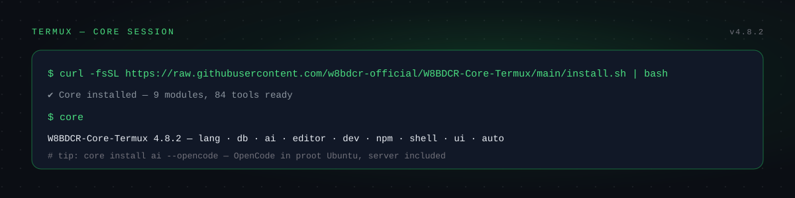

### ⚡ Power cut? Pick up where you left off:

```
core resume
```

# 🚀 W8BDCR Core — The Dev Workstation in Your Pocket

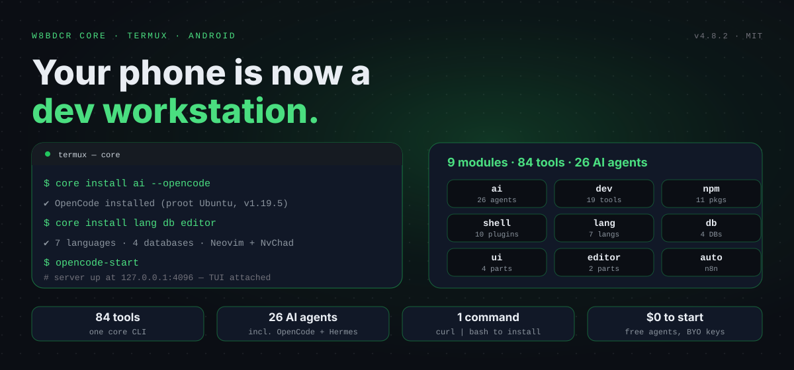

### 💰 $0 to Start — Free Tools

No token total to claim here — Core itself is free, and its AI agents run on free providers. OpenCode points at your own OmniRoute gateway (`http://localhost:20128/v1`) or any free OpenRouter `:free` model — the model key is yours, kept in an environment variable, never in the repo. What each provider gives for free is that provider's own free tier, and free quotas change with providers — the setup list below is the source of truth.

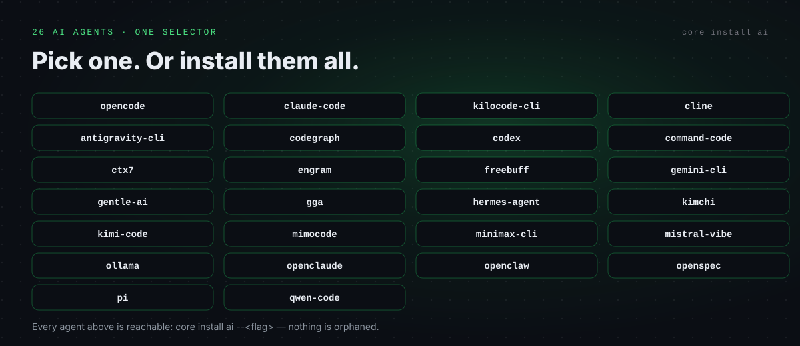

### ⭐ Star the repo if W8BDCR Core helped you

### 💬 Join the community

[](https://t.me/BDCRTEAM) [](https://t.me/BDCRTEAM) [](https://t.me/BDCRTEAM) [](https://w8bdcr.de5.net)

Questions, provider tips, roadmap & support → [@BDCRTEAM](https://t.me/BDCRTEAM) · [@w8bdcrteam](https://youtube.com/@w8bdcrteam) · @w8bdcraibot · @w8appstorebot

## 📈 The Workstation Keeps Growing

|  | Upstream | **W8BDCR Core** |
|---|---|---|
| 🤖 AI tools in the selector | 4 of 26 wired | **All 26 wired — nothing orphaned** |
| 🧩 OpenCode install | Native "recommended" | **Native, pinned v1.19.5 — verified working on phone** |
| 🐍 Hermes install | Bare curl | **Hermes-Own installer — Python 3.14, Pillow, ruamel.yaml fixes** |
| 🔄 Update check | Dead "Moded" URL (404) | **Fixed — points at this repo** |
| 🎯 AI selector | 3 tools silently installed nothing | **Fixed — all 26 dispatch** |
| 🚀 OpenCode server | Manual start | **`opencode-start` + auto-start on any `opencode` command** |

**→ Next — phone test: run the installer once on a real Termux phone and prove it end to end**

*Note: these are this repo's own fixes, verified statically against the upstream tree — your install shows its own live numbers at startup.*

## 🧭 Available

  

| **🚀 Start** | Quick Start | 📦 Install | 🆓 OpenCode first |
|---|---|---|---|
| **💡 Learn** | 💥 The Promise | 🤔 Why Core | 🏆 What Sets Apart |
| **⚙️ Features** | 🎯 Modules | 🤖 AI Agents | 🔌 Full CLI |
|  | 🗜️ Run It Free | 🖥️ Where It Runs | 🔒 Private |
| **👀 See it** | 🎬 In Action | ✨ What's New | 🛠️ Tech Stack |
| **💚 Support** | 💚 Support | 💬 Community | 💖 Sponsors |
| **📦 Project** | 📖 Docs | 👥 Contributors | 📄 License |

## 🆓 Works the second you install it — one command

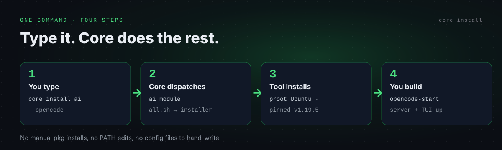

```
core install ai --opencode
```

One command, no manual `pkg` installs — Core dispatches to the module, the tool installs, you build. (Tip: `core list <module>` shows every tool and its flag before you install.)

# 💥 The Promise

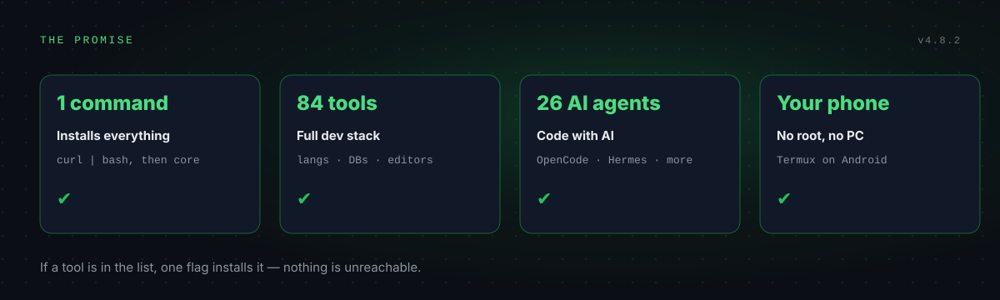

# 🤔 Why Core?

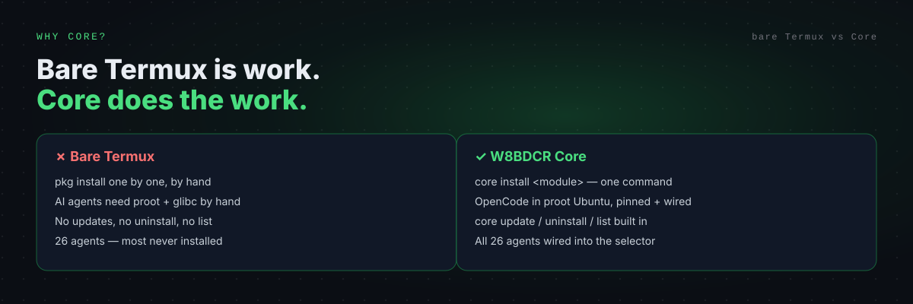

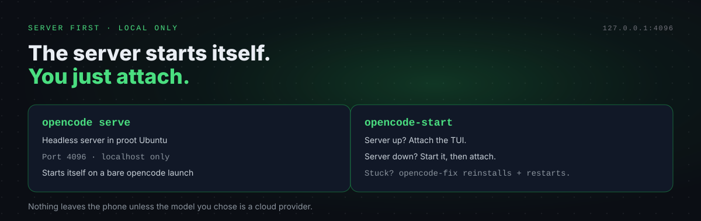

## 🤝 Supported by our Open Source Friends

No corporate backers yet — this project is kept free by W8BDCR. The friends that make it possible are the open-source projects Core is built on:

<table>
  <tr>
    <td align="center" width="150">
      <br><b>OpenCode</b><br><sub>The agentic coding agent</sub><br><br>
      
    </td>
    <td>
      Thanks to the <b>OpenCode</b> team for the open-source agent that runs as its own server on your phone — pinned v1.19.5 running natively, with <code>opencode-start</code> and auto-start on any <code>opencode</code> command.
    </td>
  </tr>
  <tr>
    <td align="center" width="150">
      <br><b>Hermes Agent</b><br><sub>By NousResearch</sub><br><br>
      
    </td>
    <td>
      Thanks to <b>NousResearch</b>, the team behind the open-source Hermes Agent, for the self-improving agent installed here through the working W8BDCR Hermes-Own installer. The agent itself is not claimed as ours.
    </td>
  </tr>
  <tr>
    <td align="center" width="150">
      <br><b>Termux</b><br><sub>The Android terminal</sub><br><br>
      
    </td>
    <td>
      Thanks to <b>Termux</b> for the terminal that makes all of this possible on a phone — no root, your storage, your shell.
    </td>
  </tr>
</table>

Want to back Core? Star the repo, or talk to us on Telegram — see Support below.

## 🎯 Modules — The Flagship

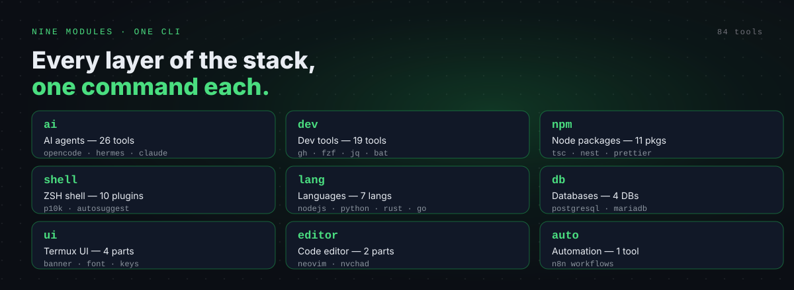

### ⚡ Nine modules, one CLI

| Module | Description | Tools | Install it |
|---|---|---|---|
| `lang` | Language packages (Node.js, Python, Perl, PHP, Rust, C/C++, Go) | 7 | `core install lang` |
| `db` | Databases (PostgreSQL, MariaDB, SQLite, MongoDB) | 4 | `core install db` |
| `ai` | AI agents and coding assistants | 26 | `core install ai` |
| `editor` | Code editor components (Neovim, NvChad) | 2 | `core install editor` |
| `dev` | Development tools (gh, wget, curl, fzf, lsd, bat, etc.) | 19 | `core install dev` |
| `npm` | Node.js global npm packages | 11 | `core install npm` |
| `shell` | ZSH plugins | 10 | `core install shell` |
| `ui` | Termux UI components | 4 | `core install ui` |
| `auto` | Automation tools (n8n) | 1 | `core install auto` |

These modules are available across most commands (`core list`, `core install`, `core update`, `core reinstall`, `core uninstall`, `core show`, `core open`, and `core resume`).

### ⚡ Power cut? `core resume`

If Termux is killed or the power goes out mid-work, run `core resume` — it restarts your services (OmniRoute gateway, OpenCode server) and continues the interrupted install from its checkpoint instead of starting over. Every `core` command also restores stopped services silently in the background.

### 🔀 Or install one tool at a time — 84 in the list

Pick one tool with `--<flag>` — the flag is the tool's directory name — or stack several in one command:

```
core install ai --opencode --claude-code --kilocode-cli --cline
core install db --postgresql --sqlite
core install dev --gh --fzf --jq
```

### 🧱 Three ways to install, built in

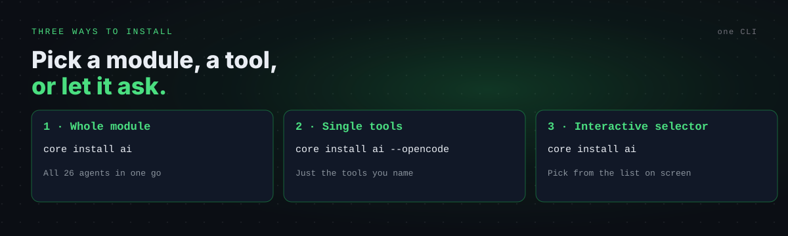

1. **Whole module** — `core install ai` installs all 26 agents in one go.
2. **Single tools** — `core install ai --opencode` installs just the tools you name.
3. **Interactive selector** — run `core install ai` with no flags and pick from the list on screen.

## 🏆 What Sets Core Apart

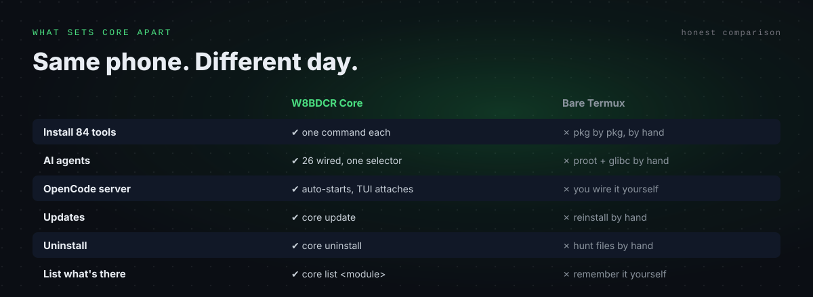

## 💚 Support Core

Core is MIT-licensed and maintained in the open. If it saves you time or money, here's how to keep it independent — pick whatever fits you.


**📱 Scan to contact @W8BDCR directly on Telegram** — point your camera at the QR code and it opens a chat with us.

| Way to support | What it is | Link |
|---|---|---|
| ⭐ **Star the repo** | Free — genuinely helps visibility | [Star W8BDCR-Core-Termux](https://github.com/w8bdcr-official/W8BDCR-Core-Termux) |
| 💬 **Telegram channel** | Updates, new tools and video links — scan the QR or tap | [@BDCRTEAM](https://t.me/BDCRTEAM) |
| 🌐 **Website** | All W8BDCR projects in one place | [w8bdcr.de5.net](https://w8bdcr.de5.net) |

No payment numbers are published here — support is via Star and Telegram only.

<br clear="right">

🐛 Found a bug or have feedback? Open an issue on the repo.

## 📡 Core Status

The framework tells you its version the moment it runs:

```
4.8.2
```

That is the output of `core --version` — the installed version of W8BDCR-Core-Termux. If a newer version exists, `core` shows an update notice on startup (the 24-hour update check runs in the background).

## ✨ What's New

Recent highlights from the W8BDCR adaptation. Full history in the repo.

- **🤖 All 26 AI agents wired** — the upstream selector only reached 4 of them; the other 22 installers existed but were unreachable. Now every agent is reachable via `core install ai` or its `--flag`.
- **🧩 OpenCode, native works** — pinned v1.19.5 linux-arm64. Native mode runs on stock Termux (verified on phone 2026-11-06: `opencode --version` → 1.19.5, TUI answers) — it is now the recommended install; Proot-distro inside Ubuntu stays as the alternative.
- **🚀 `opencode-start` and `opencode-fix` (new)** — `opencode-start` starts the server and attaches the TUI; a bare `opencode` launch auto-starts the server the same way (same pattern as the Hermes gateway); `opencode-fix` reinstalls the pinned binary and restarts the server.
- **🚀 `core-start` and `core-fix` (new — phone test pending)** — `core-start` runs Core from one small command (checks the install, then opens the selector), and `core-fix` repairs a stuck install — re-links the command, re-writes the config, re-syncs the repo — without wiping your tools or config.
- **🐍 Hermes via Hermes-Own** — installed through the working W8BDCR Hermes-Own installer (Python 3.14+, Pillow override, ruamel.yaml fix), not upstream's bare curl.
- **🎯 Selector fix** — three agents (Command Code, Kimi Code, Pi Coding Agent) silently installed nothing from the interactive selector because their case patterns were quoted; fixed — all 26 dispatch.
- **🔄 Update check fixed** — upstream's check fetched a "Moded" URL that 404s forever; it now points at this repo.
- **🖼️ Banner + font** — the upstream banner is replaced by our own W8BDCR banner (`assets/banner/w8bdcr.txt`); the font is MesloLGS Nerd Font Mono (SIL OFL 1.1, Meslo Apache 2.0 — freely redistributable, license noted in the font README).

## 🤖 AI Agents — 26

One selector — 26 agents in the install list and 9 modules built in.

### 🏢 Agents, Side by Side

| | | | | | |
|---|---|---|---|---|---|
| OpenCode | Claude Code | Cline | Kilo Code CLI | Codex | CodeGraph |
| Command Code | Context7 | Engram | Freebuff | Gemini CLI | Gentle-AI |
| GGA | Hermes Agent | Kimchi | Kimi Code | MiMoCode | MiniMax CLI |
| Mistral Vibe | Ollama | OpenClaude | OpenClaw | OpenSpec | Pi Coding Agent |
| Qwen Code | Antigravity CLI | | | | |

**+ also works with:** your own endpoint · **any OpenAI-compatible API** (the OpenCode setup takes any base URL)

### 🧰 Twenty-Six Agents, One Selector

| Agent | Flag | Description |
|---|---|---|
| Claude Code | `--claude-code` | Anthropic's CLI tool with Claude AI |
| Cline | `--cline` | Autonomous coding agent CLI (creating/editing files, running commands, browser) |
| Kilo Code CLI | `--kilocode-cli` | The open source coding agent for building with AI in VS Code, JetBrains, or the CLI |
| OpenCode | `--opencode` | Open-source agent that helps you write code in your terminal |
| Antigravity CLI | `--antigravity-cli` | Lightweight, terminal-first surface for Antigravity agents |
| CodeGraph | `--codegraph` | Analyzes your codebase structure and dependencies to improve navigation |
| Codex CLI | `--codex` | OpenAI's coding agent CLI that runs locally on your computer |
| Command Code | `--command-code` | The coding agent that learns your coding taste |
| Context7 | `--ctx7` | Up-to-date documentation for AI coding agents |
| Engram | `--engram` | Persistent memory system for AI coding agents |
| Freebuff | `--freebuff` | A 100% free coding agent, right from your terminal |
| Gemini CLI | `--gemini-cli` | Google's AI assistant with Gemini |
| Gentle-AI | `--gentle-ai` | Ecosystem, Frameworks, Workflows for AI coding agents |
| GGA | `--gga` | Provider-agnostic AI code review on every commit |
| Hermes Agent | `--hermes-agent` | The self-improving AI agent built by Nous Research |
| Kimchi | `--kimchi` | Terminal coding agent powered by Kimchi's multi-model orchestration |
| Kimi Code | `--kimi-code` | Kimi Code CLI — The Starting Point for Next-Gen Agents |
| MiMoCode | `--mimocode` | Xiaomi's AI coding agent — fast, local, and open-source |
| MiniMax CLI | `--minimax-cli` | Generate text, images, video, speech, and music from the terminal |
| Mistral Vibe | `--mistral-vibe` | Command-line coding assistant powered by Mistral's models |
| Ollama | `--ollama` | Run open-source LLMs locally on Termux |
| OpenClaude | `--openclaude` | Open source Claude Code alternative |
| OpenClaw | `--openclaw` | Personal AI Assistant |
| OpenSpec | `--openspec` | Spec-Driven Development framework for AI coding assistants |
| Pi Coding Agent | `--pi` | Minimal terminal coding harness — adapt Pi to your workflows |
| Qwen Code | `--qwen-code` | Alibaba's AI coding assistant |

26 agents install from one selector — that is the line `core list ai` shows.

## 🧠 Unique Agents — Flagship Picks

### Theirs — from the `core install ai` selector (26 agents)

| Category | Agents |
|---|---|
| Flagship | OpenCode, Hermes Agent |
| In the selector | Claude Code, Cline, Kilo Code CLI, Codex, CodeGraph, Command Code, Context7, Engram, Freebuff, Gemini CLI, Gentle-AI, GGA, Kimchi, Kimi Code, MiMoCode, MiniMax CLI, Mistral Vibe, Ollama, OpenClaude, OpenClaw, OpenSpec, Pi Coding Agent, Qwen Code, Antigravity CLI |

### W8BDCR Picks — unique agents we run

| Agent | Why it's unique | Best for |
|---|---|---|
| `opencode` (OpenCode) | Own server on your phone, pinned v1.19.5 running natively, auto-start on any `opencode` command | Free coding, server-first work |
| `hermes-agent` (Hermes) | Installed via the working Hermes-Own installer — Python 3.14, Pillow override, ruamel.yaml fix | Self-improving agent, gateway |
| OpenRouter `:free` model | `nvidia/nemotron-3-ultra-550b-a55b:free` via env var — the model the OpenCode setup uses | Free chat, coding, no card |

*Statuses are from the static check — a tool marked "in the selector" installs from `core install ai --<flag>`; the selector is the source of truth.*

### 🧩 OpenCode — the flagship agent

OpenCode runs as its **own server on your phone**. Install it with `core install ai --opencode` and pick Native — pinned v1.19.5, linux-arm64, verified working on phone (2026-11-06). Proot-distro inside Ubuntu stays as the alternative.

After install, set up the provider once, from the repo root:

```
chmod +x setup-opencode.sh
./setup-opencode.sh
```

That script asks for a provider ID, a name, a base URL, and an API key (blank if none), lists the models on that endpoint, and writes the config to `~/.config/opencode/opencode.json`. It defaults to the local OmniRoute gateway:

```
http://localhost:20128/v1
```

The free model it uses is the OpenRouter free model `nvidia/nemotron-3-ultra-550b-a55b:free` — keep your API key in an environment variable, never in the repo. Full setup notes live in the OpenCode tool README (`core show ai --opencode`).

Then start it:

```
opencode-start
```

`opencode-start` starts the server and attaches the TUI. A bare `opencode` launch does the same thing automatically (server auto-start on 127.0.0.1:4096, TUI attaches). If anything goes wrong, `opencode-fix` reinstalls the pinned binary and restarts the server. Subcommands (`serve`, `attach`, `run`, `web`, `--help`, ...) run directly against the binary, unchanged.

### 🐍 Hermes — the second flagship

Hermes is installed through the working W8BDCR Hermes-Own installer (Python 3.14+, Pillow override, ruamel.yaml fix) — not upstream's bare curl:

```
core install ai --hermes-agent
```

Hermes runs its gateway the same server-first way: `hermes gateway` starts the server, `hermes-start` starts server + chat in one command, `hermes-fix` repairs the setup. Full Hermes docs live in the [W8BDCR-Hermes-Own repo](https://github.com/w8bdcr-official/W8BDCR-Hermes-Own).

### 🔌 Other agents

Every other agent in the table above installs the same way — `core install ai --<flag>`. Each one keeps its own provider setup; the tool's own docs (`core show ai --<flag>`) explain its keys.

## 🌐 All Tools — 84

Everything Core installs, grouped by module. Each tool has its own `install.sh` in the tree, and its flag is its directory name with `--` in front.

### 🐍 Language Packages — 7

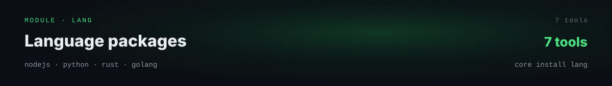

| Language/Runtime | Package | Description |
|---|---|---|
| Node.js LTS | `nodejs-lts` | Long-term support release of Node.js |
| Python | `python` | Python 3 interpreter |
| Perl | `perl` | Perl scripting language |
| PHP | `php` | PHP interpreter |
| Rust | `rust` | Rust compiler and Cargo |
| C/C++ | `clang` | LLVM C/C++ compiler |
| Go | `golang` | Go programming language |

Install flags (the flag is the tool name, not the package name — Node.js uses `--nodejs`):

```
core install lang --nodejs --python --perl --php --rust --clang --golang
```

### 🗄️ Databases — 4

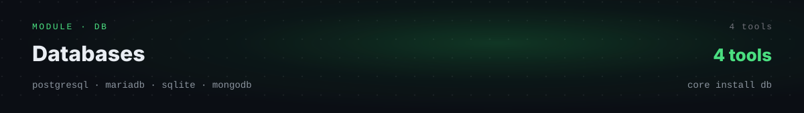

| Tool | Flag | Install command |
|---|---|---|
| **PostgreSQL** | `--postgresql` | `core install db --postgresql` |
| **MariaDB** | `--mariadb` | `core install db --mariadb` |
| **SQLite** | `--sqlite` | `core install db --sqlite` |
| **MongoDB** | `--mongodb` | `core install db --mongodb` |

```
core install db --postgresql --sqlite
```

### ✏️ Code Editor — 2

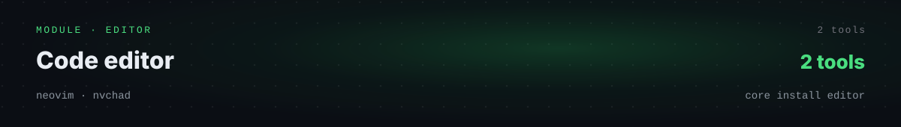

The `editor` module installs Neovim with a custom configuration based on NvChad.

```
core install editor
```

| Tool | Flag | Description |
|---|---|---|
| **Neovim** | `--neovim` | Fast, extensible code editor |
| **NvChad** | `--nvchad` | Modern Neovim configuration |

Features:

- **Neovim** — Fast, extensible code editor
- **NvChad** — Modern Neovim configuration
- **GitHub Copilot** — AI-powered code completion
- **CodeCompanion** — AI chat assistant for code
- **Preconfigured plugins** — LSP, autocomplete, syntax highlighting, file explorer, etc.

Included languages: TypeScript/JavaScript, Python, PHP, Perl, Rust, Lua, and more.

### 🛠️ Development Tools — 19

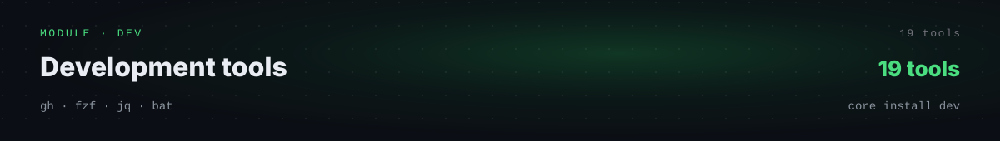

| Tool | Package | Description |
|---|---|---|
| GitHub CLI | `gh` | Official GitHub command-line tool |
| Wget | `wget` | File downloader |
| Curl | `curl` | HTTP client and transfer tool |
| LSD | `lsd` | Modern ls replacement with icons and colors |
| Bat | `bat` | Modern cat replacement with syntax highlighting |
| Proot | `proot` | Chroot alternative for user-space |
| Ncurses Utils | `ncurses-utils` | Terminal UI manipulation tools |
| Tmate | `tmate` | Instant terminal sharing |
| Cloudflared | `cloudflared` | Cloudflare Tunnel client |
| Translate Shell | `translate-shell` | Command-line translator |
| html2text | `html2text` | HTML to plain text converter |
| jq | `jq` | Lightweight JSON processor |
| bc | `bc` | Arbitrary precision calculator |
| Tree | `tree` | Recursive directory listing |
| Fzf | `fzf` | Command-line fuzzy finder |
| ImageMagick | `imagemagick` | Image manipulation suite |
| Shfmt | `shfmt` | Shell script formatter |
| Make | `make` | Build automation tool |
| Udocker | `udocker` | Run Docker containers without root |

Install flags (the flag is the tool name — Ncurses Utils uses `--ncurses`, Translate Shell uses `--translate`):

```
core install dev --gh --wget --curl --lsd --bat --proot --ncurses --tmate --cloudflared --translate --html2text --jq --bc --tree --fzf --imagemagick --shfmt --make --udocker
```

### 📦 Node.js Global Modules — 11

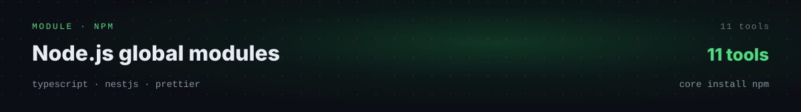

| Package | Command | Description |
|---|---|---|
| TypeScript | `tsc` | TypeScript compiler |
| NestJS CLI | `nest` | NestJS framework CLI |
| Prettier | `prettier` | Code formatter |
| Live Server | `live-server` | Development server with live reload |
| Localtunnel | `lt` | Expose localhost to the internet |
| Vercel CLI | `vercel` | Vercel deployment CLI |
| Markserv | `markserv` | Markdown live-preview server |
| PSQL Format | `psqlformat` | PostgreSQL query formatter |
| NPM Check Updates | `ncu` | Find outdated dependencies |
| Ngrok | `ngrok` | Secure tunnel to localhost |
| Turbopack | `next-turbopack` | Next.js native bundler (requires glibc toolchain) |

Install flags (the flag is the tool name — NestJS CLI uses `--nestjs`, Localtunnel uses `--localtunnel`, Turbopack uses `--turbopack`):

```
core install npm --typescript --nestjs --prettier --live-server --localtunnel --vercel --markserv --psqlformat --ncu --ngrok --turbopack
```

### 🐚 ZSH Shell — 10


| Plugin | Description |
|---|---|
| powerlevel10k | Modern and fast theme |
| zsh-defer | Deferred plugin loading |
| zsh-autosuggestions | Smart autocompletion |
| zsh-syntax-highlighting | Syntax highlighting |
| zsh-history-substring-search | History search |
| zsh-completions | Additional completions |
| fzf-tab | Fuzzy navigation in completions |
| zsh-you-should-use | Command suggestions |
| zsh-autopair | Auto-close parentheses |
| zsh-better-npm-completion | Better npm completion |

Install flags (the flag is the tool name — History search uses `--history-substring`, You Should Use uses `--you-should-use`, Better npm completion uses `--better-npm`):

```
core install shell --powerlevel10k --zsh-defer --zsh-autosuggestions --zsh-syntax-highlighting --history-substring --zsh-completions --fzf-tab --you-should-use --zsh-autopair --better-npm
```

### 🎨 Termux UI — 4

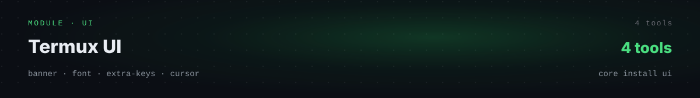

| Tool | Flag | Install command |
|---|---|---|
| **Termux Banner** | `--banner` | `core install ui --banner` |
| **Termux Font** | `--font` | `core install ui --font` |
| **Termux Extra Keys** | `--extra-keys` | `core install ui --extra-keys` |
| **Termux Cursor** | `--cursor` | `core install ui --cursor` |

### 🤖 Automation — 1

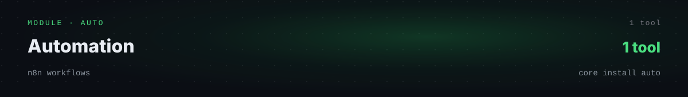

| Tool | Flag | Install command |
|---|---|---|
| **n8n** | `--n8n` | `core install auto --n8n` |

### 🤖 AI Agents — 26

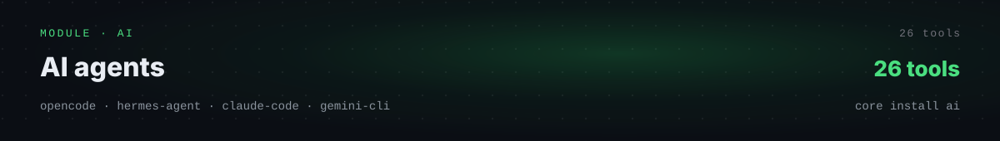

The AI module is listed in full above — see `AI Agents — 26` for the agent table, and `Unique Agents` for the flagship picks. Install the whole module, or one agent at a time:

```
core install ai
core install ai --opencode --claude-code --kilocode-cli
```

## 🌐 AI Agents

### 🏢 Every flagship agent — through one CLI

| | | | | | |
|---|---|---|---|---|---|
| OpenCode | Claude Code | Cline | Kilo Code CLI | Codex | CodeGraph |
| Command Code | Context7 | Engram | Freebuff | Gemini CLI | Gentle-AI |
| GGA | Hermes Agent | Kimchi | Kimi Code | MiMoCode | MiniMax CLI |
| Mistral Vibe | Ollama | OpenClaude | OpenClaw | OpenSpec | Pi Coding Agent |
| Qwen Code | Antigravity CLI | | | | |

…and more — every agent in the selector is in the table above.

### 🆓 Free Forever — $0, no card

| Agent | Free path | Note |
|---|---|---|
| OpenCode | OpenRouter `:free` model | `nvidia/nemotron-3-ultra-550b-a55b:free` via env var, verified |
| OpenCode | OmniRoute gateway | Your own gateway at `http://localhost:20128/v1` |
| Hermes Agent | Free providers | OpenRouter `:free`, Atria preview, Inception grant — see the Hermes-Own repo |
| Ollama | Local models | Runs on your phone, no provider needed |

Full status table → `All Tools` above.

## 🖥️ Where Core Runs

| Platform | Support | Notes |
|---|---|---|
| **Termux (Android)** | ✅ Primary | The home platform — `curl \| bash` install, `core` runs everything |
| **Ubuntu / Debian** | ✅ | Same installer, same modules |
| **Other Linux** | ⚠️ Partial | Most modules work; some Termux-specific UI parts do not apply |
| **macOS / Windows** | ❌ Not supported | Use Termux on Android or a Linux machine |

Minimum: Termux on Android with storage permission (the installer requests it for you). OpenCode runs natively (Proot-distro inside Ubuntu stays as the alternative) and works best with 6 GB RAM or more.

## 🔐 Permissions — two taps, then install

1. **Storage** — the installer runs `termux-setup-storage` and Android asks for access. Tap **Allow** on the popup. If the popup does not appear, run `termux-setup-storage` yourself and tap Allow.
2. **Battery** — Android Settings → Apps → Termux → Battery → **Unrestricted**. Without this, Android stops the OpenCode and Hermes servers when Termux goes to the background.

No root, no other permission. The installer checks storage itself and tells you if it is still missing.

### 🧩 New: Core inside your own OmniRoute gateway

Point OpenCode at http://localhost:20128/v1 and let your own OmniRoute server feed it models.

## 🔒 Private & Local-First

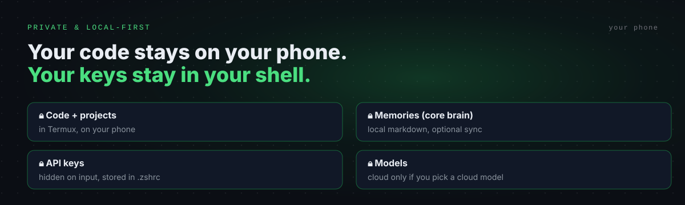

- **Your code stays on your phone.** Core installs into Termux; projects live in your storage.
- **Your keys stay in your shell.** API keys are hidden on input and stored in `~/.zshrc` — never in the repo, never in a shared file.
- **Your memories are local.** `core brain` keeps memories as local markdown files, with optional sync you turn on yourself.
- **No tracking.** Core does not phone home except the update check (your GitHub raw file) and the tools you run.
- **Cloud is opt-in.** A model only talks to the cloud if you pick a cloud provider. OmniRoute runs on `localhost`.

## 🔌 Full CLI

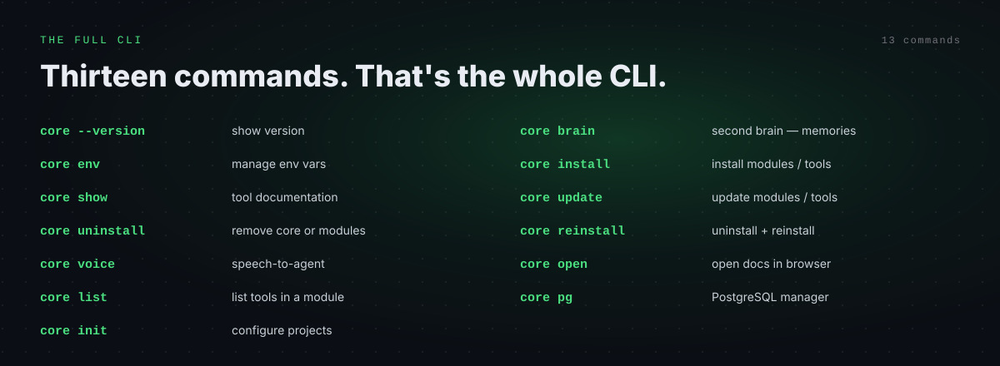

### ⌨️ A real CLI (not just start)

Thirteen commands — that's the whole CLI. Full examples for each one live under Documentation → Detailed Commands below.

| Command | Description |
|---|---|
| `core --version` | Show current version |
| `core brain` | Second brain — save and search memories |
| `core env` | Manage environment variables |
| `core install` | Install specific modules |
| `core show` | Show tool documentation |
| `core update` | Update modules or tools |
| `core uninstall` | Remove W8BDCR-Core completely or uninstall modules |
| `core reinstall` | Uninstall + reinstall modules |
| `core voice` | Speech-to-agent via microphone |
| `core open` | Open documentation in browser |
| `core list` | List available tools in modules |
| `core pg` | PostgreSQL database manager |
| `core init` | Configure existing projects |

`core-start`, `core-fix`, `core install`, `core update`, `core reinstall`, `core list`, `core --version` — the whole workstation from a handful of commands, and `core-fix` repairs it when something breaks.

### 🧠 `core brain` — and it remembers for you

`core brain` keeps memories as local markdown files: `save` / `ls` / `show` / `edit` / `delete` / `graph` / `skill` / `relate` / `sync` / `search` / `reset` / `init`. `core env` manages keys (`ls` / `set` / `unset`, values hidden while typing). `core voice` speaks to an agent (`opencode` / `claude-code` / `kilocode-cli` / `cline` / `text`). `core pg` manages PostgreSQL (`init` / `start` / `stop` / `restart` / `status` / `create` / `drop` / `list` / `shell`). `core init` configures a project (`next` / `react` / `express` / `nest`, or auto-detect).

## 🆓 Run It Free — No Card

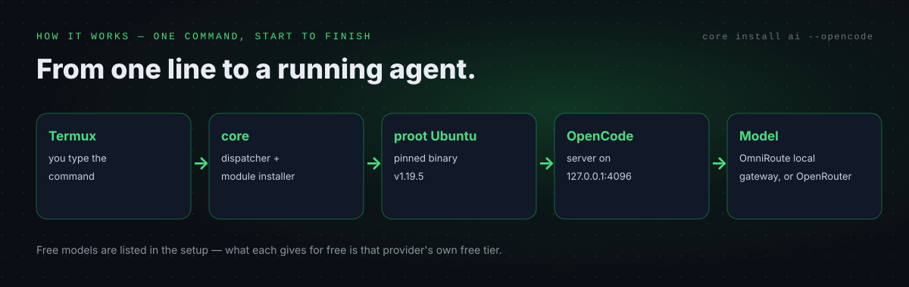

### 📖 How it works — one command, start to finish

Core itself costs nothing. The AI agents cost nothing extra to install — what you pay for is the model you point them at, and the setup list is the source of truth for what each provider gives for free:

1. **OmniRoute gateway (local)** — `http://localhost:20128/v1`. Your own gateway on your phone; add providers inside its dashboard. This is the default in `setup-opencode.sh`.
2. **OpenRouter free models** — the `:free` model in the setup (`nvidia/nemotron-3-ultra-550b-a55b:free`) via the `OPENROUTER_API_KEY` environment variable. Free quotas are the provider's own and change with them.

No key, no token, no secret is ever written into this repo — keys live in your shell environment only.

# ⚡ Quick Start

Three steps. After setup, just use it — `core` opens the selector, and every module shows its tools before anything installs.

## STEP 1 · Install Core

```bash
# ══ STEP 1 · Install Core ══
# › One command in Termux — downloads and runs the W8BDCR installer.
# › It reuses your existing setup if you run it again.
# › Already installed? Re-run this once — it updates in place.
# › and adds core-start and core-fix — one command to run it, one to repair it.
curl -fsSL "https://raw.githubusercontent.com/w8bdcr-official/W8BDCR-Core-Termux/main/install.sh?$(date +%s)" | bash
```

> 💡 The installer asks for storage access itself — tap Allow on the popup. See Permissions above if it does not appear.

### Option 2 — Clone manually

```
git clone https://github.com/w8bdcr-official/W8BDCR-Core-Termux
cd W8BDCR-Core-Termux
chmod +x install.sh
./install.sh
```

## STEP 2 · Use Core

```bash
# ══ STEP 2 · Use Core ══
# › Run this once, after the install finishes.
# › It opens the interactive selector: pick a module, pick a tool, it installs.
core
```

### ⚙️ Essential commands

```
core install ai --opencode # Install OpenCode (AI agent, native)
core install ai --hermes-agent # Install Hermes Agent
core install ai # Interactive AI agent selector
core install lang --nodejs # Install Node.js
core install db --postgresql # Install PostgreSQL
core install editor --neovim # Install Neovim
core install dev --fzf # Install fzf
core list ai # List all AI agents
core update # Update everything
core --version # Show version
core brain # Second brain — memories
```

### ⚡ Examples

- **Install all languages:** `core install lang`
- **Install Node.js + Python:** `core install lang --nodejs --python`
- **Install specific AI agents:** `core install ai --opencode --claude-code --gemini-cli`
- **Install everything in a module:** `core install db`

> 💡 Tip: run `core list <module>` to see all available tools and their flags before you install.

## STEP 3 · Your setup (optional)

```bash
# ══ STEP 3 · Your setup (optional) ══
# › Set a profile name and keys with core env.
# › Customize the banner (see Banner Tips under Documentation).
# › Connect a provider: run the OpenCode setup script, or core env for keys.
# › Want the full run in one go? core-start checks the install and opens Core together.
core env
```

| Command | What it does |
|---|---|
| `core-start` | Check the install, then open Core — one command |
| `core-fix` | Install stuck or broken? Repairs it without wiping your tools or config |

### 🧩 Configure a project with `core init`

| Template | Command | What it sets up |
|---|---|---|
| Next.js | `core init next` | Turbopack & LightningCSS support, Tailwind CSS, platform native bindings |
| React + Vite | `core init react` | Same dependencies as Next.js (except Next.js-specific configs), `.prettierrc` with Tailwind CSS plugin |
| Express.js | `core init express` | `express, pg, typeorm, reflect-metadata, jsonwebtoken, cookie-parser, morgan, cors` |
| NestJS | `core init nest` | `@nestjs/typeorm, typeorm, pg, @nestjs/jwt, @nestjs/passport` |

`core init` with no template auto-detects the project type and configures it.

### 📦 More commands

| Command | What it does |
|---|---|
| `core` | Show module selector |
| `core brain` | Second brain — save and search memories |
| `core env` | Manage environment variables |
| `core install` | Install specific modules |
| `core show` | Show tool documentation |
| `core update` | Update modules or tools |
| `core uninstall` | Remove W8BDCR-Core completely or uninstall modules |
| `core reinstall` | Uninstall + reinstall modules |
| `core voice` | Speech-to-agent via microphone |
| `core open` | Open documentation in browser |
| `core list` | List available tools in modules |
| `core pg` | PostgreSQL database manager |
| `core init` | Configure existing projects |
| `core --version` | Show current version |

### ⚡ Updating

The installer has no separate updater — re-running the install command updates Core in place and reuses your existing setup.

```
curl -fsSL "https://raw.githubusercontent.com/w8bdcr-official/W8BDCR-Core-Termux/main/install.sh?$(date +%s)" | bash
```

Or update tools in place:

```
core update # Update all installed modules
core update ai # Update AI agents
core update lang --nodejs # Update Node.js
core update ai --opencode # Specific AI tool only
```

# 🎬 Core in Action

The fastest way to see Core is to run it: `core` opens the selector, and every module shows its tools with descriptions before anything installs.

- **One command, one agent:** `core install ai --opencode` → OpenCode running as a local server.
- **One command, one stack:** `core install lang --nodejs --python --golang` → three languages, no manual `pkg` installs.
- **One command, one database:** `core install db --postgresql` → PostgreSQL, then `core pg` to manage it.

# 📧 Community & Help

| Channel | Where / how |
|---|---|
| 💬 Telegram — W8BDCR community | https://t.me/BDCRTEAM |
| 🎬 YouTube — W8BDCR team | https://youtube.com/@w8bdcrteam |
| 🤖 Telegram bot | @w8bdcraibot |
| 🛒 Telegram app store bot | @w8appstorebot |
| 🐙 GitHub | https://github.com/w8bdcr-official |
| 📦 Source code | https://github.com/w8bdcr-official/W8BDCR-Core-Termux |
| 🐛 Report a bug | Open an issue on the repo |
| 🤝 Contribute | See below |
| 💚 Support the project | See Support section above |

## 🛠️ Tech Stack

| Layer | Stack |
|---|---|
| Shell | Bash — the `core` dispatcher and every installer |
| Runtime | Termux on Android; Ubuntu / Debian on Linux |
| AI agents | OpenCode (native, pinned v1.19.5), Hermes (Python 3.14), 24 more |
| Gateway | OmniRoute on `http://localhost:20128/v1` (local) |
| Editor | Neovim + NvChad |
| Shell UI | ZSH + Oh My Zsh + Powerlevel10k |
| Automation | n8n |
| Diagrams | Hand-drawn SVG (docs/diagrams/) |

## 📖 Documentation

| Doc | Where |
|---|---|
| Getting Started | README Install & Quick Start |
| The moving parts | `docs/diagrams/` |
| Who powers your Core | All Tools above |
| When something breaks | Troubleshooting below |
| Project & Quality | LICENSE |

### 📘 Getting Started

Start with Install & run, then Quick Start — after setup, just run `core`; the selector opens and every module shows its tools before anything installs.

| What | Where |
|---|---|
| Install | Quick Start above — one `curl \| bash` |
| First run | `core` — interactive selector |
| First agent | `core install ai --opencode`, then `opencode-start` |
| First language | `core install lang --nodejs` |
| First database | `core install db --postgresql`, then `core pg` |
| Keys | `core env` — hidden on input, stored in `~/.zshrc` |

### 🔄 The Moving Parts

Termux → `core` dispatcher → modules → tools → your project. Diagrams in `docs/diagrams/`.

- **Root installer (`install.sh`)** — downloads the framework, sets up the `core` command, adds its path to your shell.
- **`core` dispatcher (`core/bin/core` → `core/cli/core.sh`)** — resolves its own location, loads the environment, routes your command to the right command file in `core/cli/commands/`.
- **Modules (`core/modules/<name>.sh`)** — one dispatcher per module (`ai.sh`, `lang.sh`, `db.sh`, `editor.sh`, `dev.sh`, `npm.sh`, `shell.sh`, `ui.sh`, `auto.sh`); each handles install / update / uninstall / reinstall for every tool in that module.
- **Tools (`core/tools/<module>/<tool>/install.sh`)** — one installer per tool, each self-contained; every tool directory also holds its own `README.md`, and some ship a `bin/` wrapper and a `helper/` C source.
- **Templates (`core/templates/`)** — config templates for shells, editors, and tools.
- **Docs (`core/docs/`)** — per-tool documentation, opened with `core show` or `core open`.
- **Utils (`core/utils/`)** — shared helpers: `banner.sh`, `bootstrap.sh`, `colors.sh`, `env.sh`, `log.sh`.
- **Assets (`assets/`)** — banner (`assets/banner/w8bdcr.txt`) and font (`assets/fonts/font.ttf`, MesloLGS Nerd Font Mono).

```
W8BDCR-Core-Termux/
├── install.sh            # Root installer
├── setup-opencode.sh     # OpenCode provider setup (OmniRoute default)
├── core/
│   ├── bin/core          # The `core` entry point
│   ├── cli/commands/     # 13 commands
│   ├── modules/          # 9 module dispatchers
│   ├── tools/            # 84 tool installers
│   ├── templates/        # Project + tool templates
│   ├── docs/             # Per-tool docs
│   └── utils/            # Shared helpers
├── assets/               # Banner + font
└── docs/                 # README diagrams
```

### 🧠 Who Powers Core

- **Upstream framework** — the open-source modular dev environment this repo adapts (MIT — copyright retained in LICENSE).
- **W8BDCR adaptation** — install URL, branding, OpenCode native fix, Hermes-Own installer, selector fix, update-check fix.
- **OpenCode** — the agentic coding agent, pinned v1.19.5.
- **Hermes** — the W8BDCR Hermes-Own agent.
- **OmniRoute** — the local gateway at `http://localhost:20128/v1`.

### 🩺 When Something Breaks

| Problem | Cause | Fix |
|---|---|---|
| A tool fails to install | Bad download or missing dep | Run `core reinstall <module> --<flag>` for that one tool |
| OpenCode stuck | Server down or binary stale | Run `opencode-fix` — it reinstalls the pinned binary and restarts the server |
| Hermes stuck | Gateway or setup issue | Run `hermes-fix` (from the Hermes-Own install) |
| Still stuck after a reinstall | Framework files out of sync | Re-run the installer — it repairs the framework in place |
| Nothing above works | Unknown state | Open an issue on the repo or ask on [@BDCRTEAM](https://t.me/BDCRTEAM) |

### 📋 Project & Quality

- **License:** MIT — copyright retained unchanged (see LICENSE).
- **Version:** 4.8.2 (`core --version`).
- **Checks run on this tree:** `bash -n` on every `.sh` file passes; every tool has an `install.sh`; every module dispatcher handles install / update / uninstall / reinstall for all its tools; all 26 AI agents are wired into the selector.
- **What is not verified here:** the installer has not run on a real phone in this build — the phone test is yours (see What's New).

### ⚙️ Configuration

```
export CORE_DEBUG=1    # Enable debug logs
```

| Directory | Description |
|---|---|
| `~/.local/share/core-termux-data` | Persistent tool data |
| `~/.cache/core-termux` | Logs and cache |
| `~/.config/core-termux` | User configuration |

All processes save logs to `~/.cache/core-termux/` — one log per module (`install_ai.log`, `install_lang.log`, `install_db.log`, `install_editor.log`, `install_dev.log`, `install_npm.log`, `install_shell.log`, `install_ui.log`, `install_auto.log`, `postgresql.log`), plus `last_version_check` (last update check timestamp) and `new_version` (new version available, if exists).

The framework checks for updates automatically — once every 24 hours, in the background, no impact. The notice shows when you run `core` if a new version exists. Example notice (illustrative — your install shows its own numbers):

```
$ core

── Update Available ─────────────────────────────────

⚠ New version available: 4.8.3 (current: 4.8.2)

➜ Reinstall W8BDCR-Core-Termux to update
```

### 🐚 ZSH Shell

When installing the `shell` module, restart Termux to apply changes. The shell saves the current directory to `~/.cache/core-termux/last_dir` and restores it when opening a new session (falls back to `$HOME` if the directory doesn't exist). The 10 plugins are listed above under All Tools.

### 🎨 UI and Logs

Log functions, loading spinner, separators, boxes and tables are shared helpers in `core/utils/` — every installer prints the same way. Interactive inputs cover text, confirmation (y/n), selection with arrow keys, hidden input (API keys, tokens, passwords) and multi-line input. The banner picks a random tip from a pool of 36 tips on each session and never shows the same tip twice in a row.

### 📝 Important Notes

- **Restart Termux:** After installing `shell` or `ui`, restart Termux to apply changes
- **Permissions:** Ensure you have write permissions in the installation directory
- **Connection:** Some installations require internet connection
- **Logs:** Check `~/.cache/core-termux/` if something fails
- **Native OpenCode.** OpenCode runs natively on stock Termux (verified on phone 2026-11-06) — pick Native at install time; Proot-distro inside Ubuntu stays as the alternative.
- **RAM.** OpenCode works best with 6 GB RAM or more. On smaller phones it still runs, but slowly.
- **Keys.** Never paste a full API key into chat or a shared file. `core env` stores keys in `~/.zshrc` on your phone only.

# ⭐ Top Contributors

[](https://github.com/w8bdcr-official/W8BDCR-Core-Termux/graphs/contributors)

| Contributor | Role |
|---|---|
| W8BDCR | Installer, framework, README |

### External contributors by merged pull requests

Listed from merged pull requests to this repo.

### GitHub-attributed commits

Listed from GitHub commit attribution for this repo.

## 💖 Sponsors

No sponsors yet — this project is kept free by W8BDCR. If it helps you, star the repo or talk to us on Telegram — see Support above.

## 👥 Contributors

[](https://github.com/w8bdcr-official/W8BDCR-Core-Termux/graphs/contributors)

*This repo's own contributor grid — it fills in as contributors arrive.*

| Contributor | Role |
|---|---|
| W8BDCR | Installer, framework, README |

### How to Contribute

1. Fork the repository
2. Branch from `main`
3. Create your feature branch (`git checkout -b feat/amazing-feature`)
4. Commit your changes (`git commit -m 'feat: add amazing feature'`)
5. Push to the branch (`git push origin feat/amazing-feature`)
6. Open a Pull Request

### Updating the Installer

```
# Edit install.sh, test it on a real Termux phone, then commit
git commit -m 'fix: ...'
```

## 📊 Stars

[](https://www.star-history.com/?repos=w8bdcr-official%2FW8BDCR-Core-Termux&type=date)

Star history for this repo — the chart fills in as stars arrive. See the live chart at [star-history.com](https://www.star-history.com/?repos=w8bdcr-official%2FW8BDCR-Core-Termux&type=date).

## 🌍 StarMapper

[](https://starmapper.bruniaux.com/w8bdcr-official/W8BDCR-Core-Termux)

*The map is generated from this repo's own stargazers, so it fills in as stars arrive.*

## 🙏 Acknowledgments

The framework is built on open-source software. The projects below are what Core is built on.

| Project | Note |
|---|---|
| [OpenCode](https://github.com/anomalyco/opencode) | The agentic coding agent at the heart of the AI module |
| [Hermes Agent — NousResearch](https://github.com/NousResearch/hermes-agent) | The upstream open-source agent installed via Hermes-Own |
| [Termux](https://termux.dev) | The Android terminal this runs in |
| [proot-distro](https://github.com/termux/proot-distro) | The Ubuntu container inside Termux |
| [Python](https://www.python.org) | 3.14+ runtime for the Hermes agent |
| [uv](https://github.com/astral-sh/uv) | Fast Python installer used by the Hermes installer |
| [n8n](https://n8n.io) | Automation workflows in the `auto` module |
| [OmniRoute](https://github.com/w8bdcr-official/W8BDCR-OmniRoute-Own) | The local AI gateway Core points OpenCode at |

## 📄 License

MIT License - see [LICENSE](LICENSE) for details.

**Note:** this repo holds W8BDCR's own Core framework code.

---

**[⬆ Back to top](#-1-install--run) · Built with ❤️ for the open-source AI community.**

W8BDCR Core · Termux · MIT License
